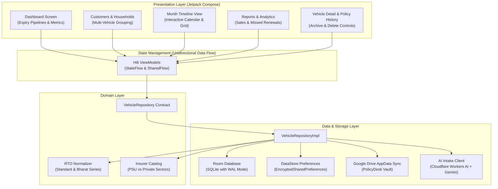
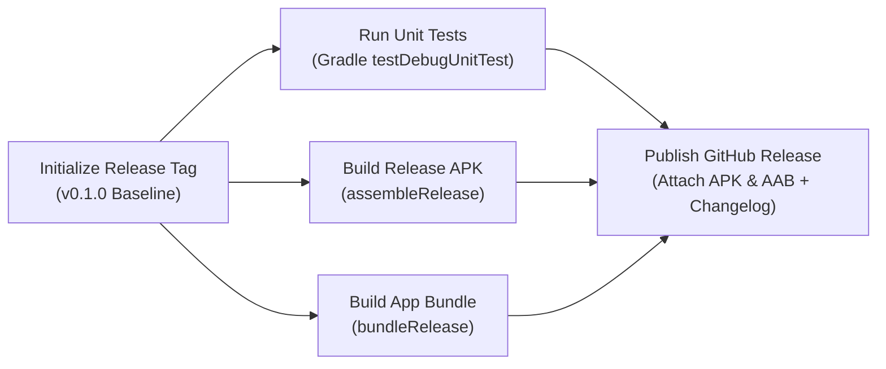

# PolicyDesk

[](https://github.com/thesatyamjain/PolicyDesk/actions/workflows/android-ci.yml)
[](https://github.com/thesatyamjain/PolicyDesk/actions/workflows/release.yml)
[-34D399.svg?logo=android&logoColor=white)](https://android.com)
[](https://kotlinlang.org)
[](https://developer.android.com/jetpack/compose)
[](https://github.com/thesatyamjain/PolicyDesk/releases)
[](LICENSE)

**PolicyDesk** is an enterprise-grade, offline-first motor insurance policy management CRM engineered natively for Android using Jetpack Compose and Apple Liquid Glass aesthetics. Built specifically for Indian insurance advisors, agencies, and fleet managers, it simplifies tracking renewal pipelines, normalizing Indian RTO registrations, dispatching personalized WhatsApp reminders, and parsing policy PDFs using Cloudflare Workers AI and Google Gemini.

---

## Architecture Overview



---

## Key Features

### 1. Apple Liquid Glass UI & 60-120 FPS Motion
- **Native GPU Surface Rendering:** True dual-incident specular borders (`1.1dp` highlight), 4-stop diagonal meniscus refraction gradients, and surface luminance hierarchy.
- **Draw-Phase Transformations:** Tap feedback and scale springs execute directly in Compose's hardware draw phase (`Modifier.graphicsLayer`) to eliminate layout remeasure passes and prevent dropped frames.
- **Virtualized Node Recycling:** Explicit `contentType` tagging across all `LazyColumn` lists for instantaneous scrolling through 1,000+ active records.
- **Full Edge-to-Edge Navigation:** Translucent frosted navigation bar and floating Liquid Glass Dock suspended over content with system gesture bar padding.

### 2. Indian RTO Registration Engine
- **Intelligent Normalizer:** Standardizes any registration format into canonical alphanumeric strings (`DL 01 AB 1234`, `mh-12-cd-5678`, `22bh1234aa`).
- **Authentic HSRP Number Plate Display:** Renders high-security registration plates with the international blue `IND` stripe, chromium hologram symbol, and distinct commercial (yellow) versus private (white) color schemes.
- **State & District Code Validation:** Comprehensive lookup across all 36 Indian states and union territories.

### 3. PSU vs. Private Insurer Intelligence
- Pre-loaded catalog containing Indian motor insurers (United India, National Insurance, New India Assurance, Oriental, ICICI Lombard, HDFC ERGO, Bajaj Allianz, Tata AIG, etc.).
- Automated classification into **PSU** and **Private** company sectors with tailored analytics.

### 4. Automated Communications & Advisor Branding
- **Custom Advisor Profile:** Configurable agent name, agency designation, phone number, and custom message templates saved in secure preferences.
- **Dynamic Renewal Placeholders:** One-tap direct WhatsApp links and SMS messages automatically interpolated with `{customer}`, `{vehicle}`, `{insurer}`, `{expiry}`, and `{signature}`.
- **Daily Digest & Expiry Alerts:** WorkManager background reminders scheduled at 30-day, 15-day, 7-day, 1-day, and same-day intervals.

### 5. Multi-Vehicle Household Grouping
- Automatically identifies multi-vehicle fleets belonging to the same family or business by indexing customer mobile numbers without requiring manual account linking.

### 6. AI PDF Policy Intake & Bulk Spreadsheet Import
- **Multimodal AI Extraction:** Primary extraction powered by Cloudflare Workers AI (`Llama 3.2 Vision`) with automatic fallback to Google Gemini 1.5 Flash.
- **Excel & CSV Importer:** Native Apache POI-free memory-efficient spreadsheet parser supporting column auto-mapping and duplicate conflict resolution.

### 7. Data Privacy & Cloud Backup
- **Offline-First:** All client and policy records reside locally on the device in encrypted SQLite storage.
- **Google Drive Vault Sync:** One-tap silent backup and restore directly to the user's hidden Google Drive `AppData` sandbox.
- **Biometric Security:** Hardware-backed `BiometricPrompt` supporting fingerprint, face unlock, and device PIN credentials.

---

## Parallel CI/CD Release Pipeline

PolicyDesk uses a multi-job asynchronous DAG in GitHub Actions to build, verify, and publish releases concurrently:



### Pipeline Performance Advantages:
- **Concurrent Execution:** Unit testing, APK compilation, and `.aab` bundle generation run in parallel across independent Ubuntu runners.
- **Self-Healing Signing:** Automatically generates a secure CI release keystore on the fly if custom repository secrets are not configured, guaranteeing that release artifacts are always properly signed.
- **Automated Version Bumping:** Supports `patch` (e.g. `v0.1.0` &rarr; `v0.1.1`), `minor` (`v0.2.0`), or `major` (`v1.0.0`) semantic version increments on demand.

---

## Tech Stack

| Layer | Technologies |
|---|---|
| **Language & Tooling** | Kotlin 2.0.21, Kotlin Symbol Processing (KSP), Gradle 8.14 |
| **UI Framework** | Jetpack Compose, Material 3, Compose Navigation, Haze Blur |
| **Architecture** | Clean Architecture, MVVM, Unidirectional Data Flow (UDF) |
| **Dependency Injection** | Dagger Hilt 2.51.1 |
| **Local Persistence** | AndroidX Room 2.6.1 (SQLite WAL), DataStore Preferences |
| **Background Processing**| AndroidX WorkManager 2.10.0 |
| **Security & Cryptography**| AndroidX Security Crypto (`EncryptedSharedPreferences`), AndroidX Biometric |
| **AI Document Intake** | Cloudflare Workers AI (`Llama 3.2 Vision`), Google Gemini REST API |
| **Cloud Synchronization**| Google Sign-In SDK, Google Drive REST API (Hidden AppData Scope) |

---

## Getting Started

### Prerequisites
- **Android Studio:** Ladybug (2024.2) or newer
- **JDK:** Version 17 (e.g., Eclipse Temurin 17)
- **Android SDK:** Compile SDK 35, Min SDK 26 (Android 8.0 Oreo)

### Local Build Commands

```bash
# Clone the repository
git clone https://github.com/thesatyamjain/PolicyDesk.git
cd PolicyDesk

# Run all unit tests
./gradlew testDebugUnitTest

# Compile debug APK
./gradlew assembleDebug

# Compile production-optimized release APK (R8 Minified)
./gradlew assembleRelease

# Compile Google Play Store App Bundle (.aab)
./gradlew bundleRelease
```

---

## Production Distribution Artifacts

| Distribution Target | Format | Output Location |
|---|---|---|
| **Sideload / Direct Install** | `.apk` | `app/build/outputs/apk/release/app-release.apk` |
| **Google Play Console** | `.aab` | `app/build/outputs/bundle/release/app-release.aab` |

---

## Publishing a Release

### Via GitHub Actions (Recommended)
1. Go to the **Actions** tab in your repository.
2. Select **Publish GitHub Release** from the left workflow list.
3. Click **Run workflow**, choose your version bump type (`patch`, `minor`, `major`), and run.
4. The parallel runner matrix will execute tests and builds simultaneously, then attach `PolicyDesk-v*.apk` and `PolicyDesk-v*.aab` directly to the newly created GitHub Release.

### Via Git CLI
```bash
git tag -a v0.1.0 -m "Release v0.1.0"
git push origin v0.1.0
```

---

## Credits & Author

Built with precision by **The Software Labs** ([thesoftwarelabs.pages.dev](https://thesoftwarelabs.pages.dev)) and **Satyam Jain**.

---

## License

This project is licensed under the MIT License - see the [LICENSE](LICENSE) file for details.
